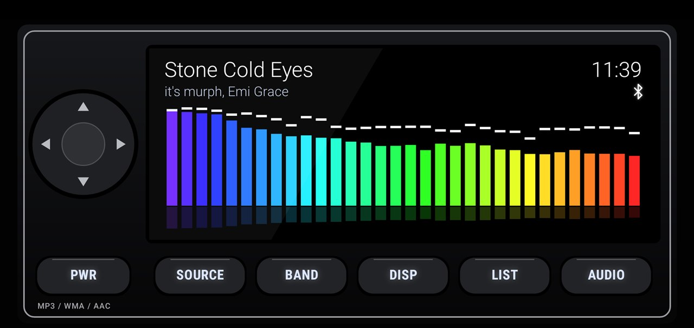
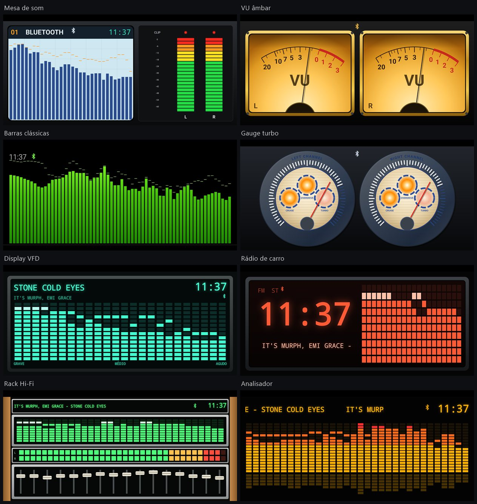
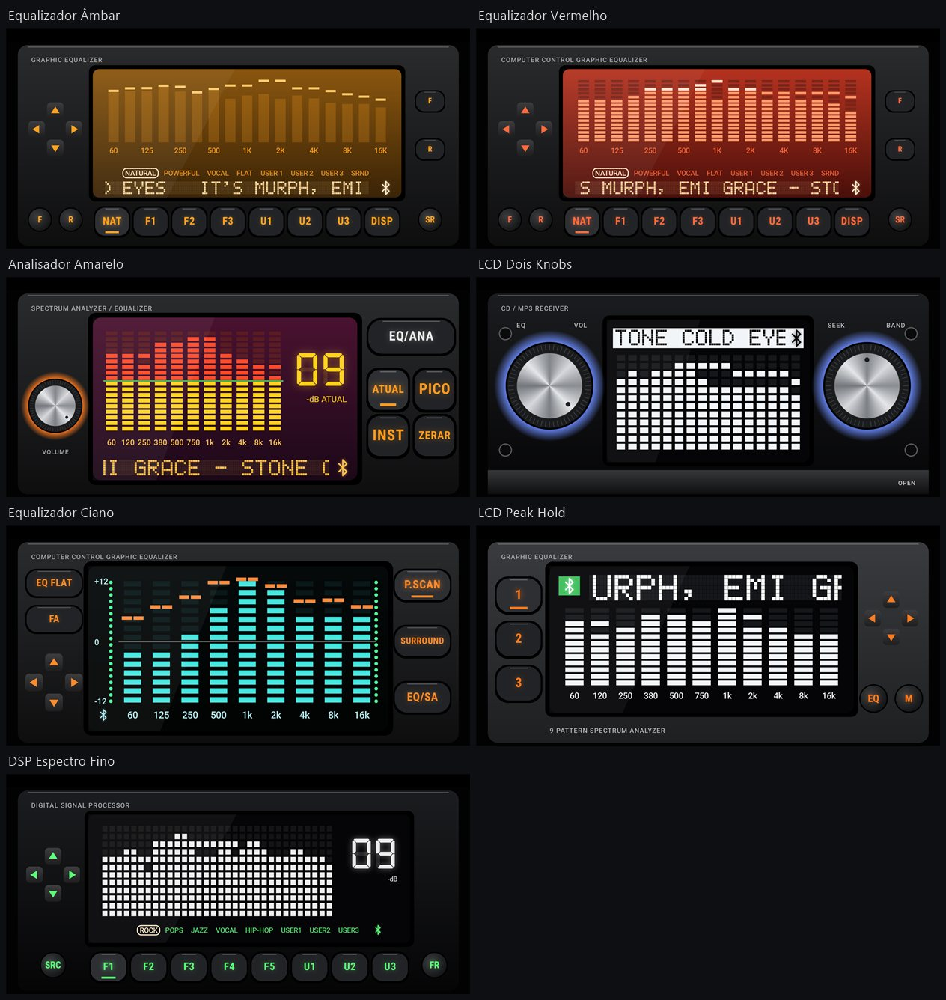
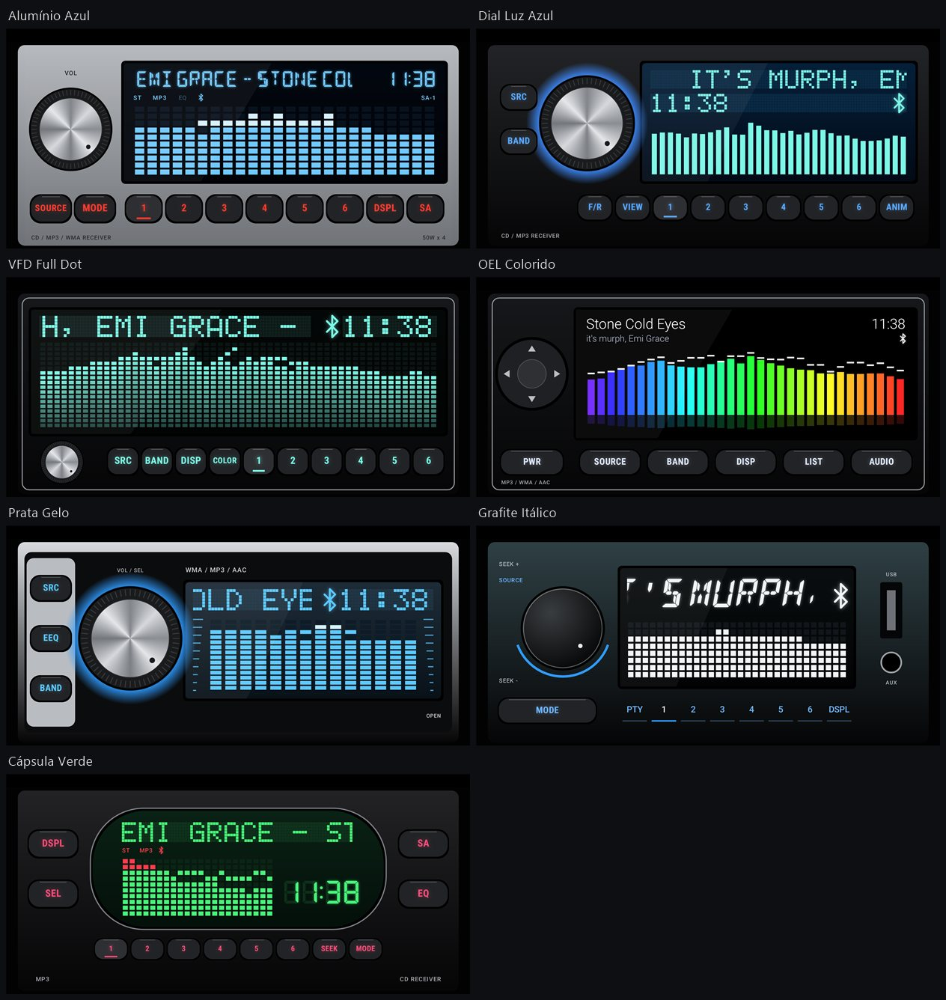
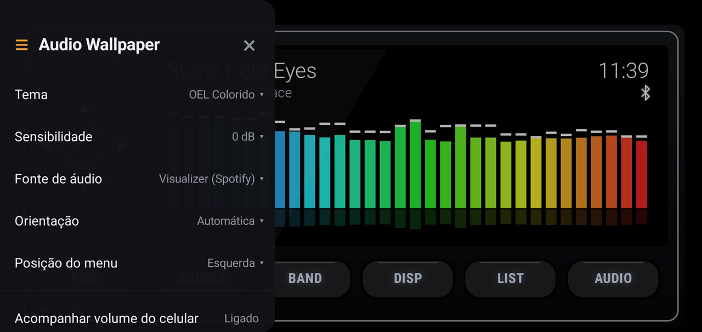

# Audio Wallpaper

**Transforme o celular no painel de um som de carro.** O app escuta a música que está tocando e desenha o espectro em tempo real, em 37 temas inspirados em equalizadores, toca-fitas e toca-CDs dos anos 90 e 2000. Foi feito para usar deitado no painel, ligado no som do carro por Bluetooth.

## ⬇️ Baixar

Pegue o arquivo **`AudioWallpaper-x.y.apk`** na [última versão](../../releases/latest).

1. Abra o APK no celular. Se o Android pedir, permita instalar apps dessa fonte (navegador ou gerenciador de arquivos).
2. Na primeira abertura, aceite a permissão de áudio.
3. No menu, em **Nome da música**, libere o acesso a notificações para o título e o artista aparecerem no display.

Precisa de **Android 9 ou mais novo**. Testado num Galaxy S10+ com Android 12 e num tablet de 11".

> Tinha uma versão anterior à 1.5? Desinstale uma vez antes de instalar: a partir da 1.5 o app é assinado com uma chave nova.

## O que ele faz

- 🎚️ **Espectro de verdade:** cada barra mostra uma faixa real de frequência, de 45 Hz a 16 kHz. Graves à esquerda, agudos à direita.
- 📻 **37 temas:** de VU analógico a rádio 1 DIN e painel full-dot animado, com botões e dials desenhados. Marque os preferidos com a estrela.
- 🎵 **Nome da música:** título e artista no display de cada aparelho, rolando quando não cabem.
- 🎛️ **Botões que funcionam:** play/pause, faixa anterior e próxima e volume pelos botões e dials do tema, com Spotify e outros apps.
- 🔵 **Bluetooth e bateria:** ícone quando há fone ou som do carro conectado, e a bateria no estilo do display de cada tema.
- 🌙 **Modo noite:** escurece sozinho no escuro, pelo sensor de luz.
- 🛡️ **Cuida da tela e do calor:** a imagem anda devagar para não marcar a tela, e o app baixa o brilho se a bateria esquentar.
- 📐 **Sempre deitado:** gira entre os dois lados ou fica travado no lado que você escolher.

## Os temas

### Clássicos

### Aparelhos dos anos 90

### Aparelhos dos anos 2000

### Cabine dos anos 90, cabine dos anos 2000, painéis com animação e rádios 1 DIN
Toca-fitas com carretéis girando, sintonia de FM com agulha, EQ de sliders, subwoofer, trocador de CD, anel de LEDs, cinco painéis full-dot animados (cidade neon, estrada retrô, oceano, fogos, galáxia) e quatro rádios 1 DIN.

Os temas são recriações inspiradas no estilo da época. Nenhum usa marca ou modelo real.

## Como usar

| Gesto | O que acontece |
|---|---|
| Toque rápido com **2 dedos** | Próximo tema |
| Deslizar com **2 dedos** | Tema seguinte ou anterior |
| **Segurar** a tela | Abre o menu lateral |
| Toque com **1 dedo** | Aperta os botões desenhados no tema |
| Botão **voltar** | Fecha o menu, ou deixa o app em segundo plano |

Nos aparelhos de som, os botões funcionam como num rádio de verdade:

| Botão | O que faz |
|---|---|
| Display | Play / pause |
| ◀ ▶, `F` / `R`, `SEEK` | Faixa anterior / próxima |
| ▲ ▼ do direcional ou joystick | Volume |
| Dial de volume | Segure até o anel acender e gire |

Para evitar toque acidental no carro, o botão só vale depois de segurar um tempo, escolhido no menu em **Botões do aparelho** (o padrão é 0,5 s).

### O menu

Favoritos, tema, sensibilidade, botões do aparelho, fonte de áudio, orientação, posição do menu, acompanhar o volume do celular, proteção contra marcas na tela, modo noite, bateria na tela e nome da música.

## De onde vem o áudio

| Fonte | Funciona com | Observação |
|---|---|---|
| **Som do aparelho** (padrão) | Spotify, YouTube e qualquer app | Lê o som que sai do aparelho, sem pedir para gravar a tela |
| **Microfone** | Qualquer som no ambiente | Plano B, ouve também o barulho em volta |

## Privacidade

O app não tem internet: não pede essa permissão, não tem anúncios nem coleta dados. O áudio é analisado na hora e não é gravado. O acesso a notificações serve só para ler a música que está tocando.

## Créditos

Os números e letras de segmentos usam a fonte [DSEG](https://github.com/keshikan/DSEG), sob licença OFL. O texto da licença está em [`licenses/`](licenses/OFL-DSEG.txt).
